# Soluciones de Sincronización Universal para CineDúo

Este documento analiza por qué enlaces protegidos (como `playmogo.com`) no se pueden controlar por código desde un servidor central y detalla las soluciones técnicas reales para lograr **sincronización 100% automática** (play, pause, seek) sin depender de que los usuarios sincronicen a mano por el chat.

---

## 1. El Problema Técnico: Bloqueos y Seguridad Web

Cuando se intenta reproducir una página arbitraria de streaming externa en un reproductor web sincronizado, surgen tres barreras fundamentales del navegador y la infraestructura web:

1. **Cloudflare Bot Management / Turnstile (HTTP 403)**:
   - Sitios como `playmogo.com` o servidores de video modernos detectan peticiones provenientes de servidores backend o bots y exigen un desafío interactivo en el navegador del usuario real.
   - Un backend no puede resolver estos retos ni ejecutar scripts propietarios sin violar políticas y ser bloqueado.
2. **Same-Origin Policy (SOP) en iframes**:
   - Por seguridad de los navegadores, una aplicación web (`cineduo.local`) no tiene acceso al DOM ni a los eventos internos (`play`, `pause`, `currentTime`) de un `<iframe>` de otro dominio (`playmogo.com`), a menos que dicho dominio exponga una API de `postMessage` (como sí hacen YouTube y Vimeo).
3. **Restricción de IP y Cookies en CDNs**:
   - Muchos hosts generan enlaces `.m3u8` firmados ligados a la dirección IP pública y User-Agent de quien cargó la página. Si un usuario extrae el stream, sus amigos en otras redes reciben error `403 Forbidden`.

---

## 2. Comparativa de Soluciones Reales

A continuación se presentan las 3 alternativas técnicas utilizadas por plataformas como Discord, Teleparty (Netflix Party) y Scener para resolver este desafío de raíz:

```mermaid
flowchart TD
    subgraph S1["Opción 1: WebRTC Tab Share (Estilo Discord)"]
        H1[Host abre pestaña con video] -->|Captura getDisplayMedia| C1[CineDúo WebRTC Engine]
        C1 -->|Streaming P2P baja latencia| G1[Invitados ven video y audio sincronizado]
    end

    subgraph S2["Opción 2: Extensión Web (Estilo Teleparty)"]
        H2[Host da Play en la web externa] -->|Extensión inyectada| W2[WebSocket CineDúo]
        W2 -->|Evento de sincronización| G2[Extensión de invitados da Play en su pestaña]
    end

    subgraph S3["Opción 3: Proxy Transcoder Local / Servidor"]
        H3[Host extrae stream] -->|Pasa token/cookies| P3[Proxy Relay CineDúo]
        P3 -->|Reempaqueta stream HLS| G3[Reproductor CineDúo nativo]
    end
```

---

## 3. Detalle de las Soluciones

### Opción 1: Retransmisión de Pestaña con Audio vía WebRTC (Estilo Discord Watch Party)
*Recomendada para soporte inmediato del 100% de páginas sin requerir extensiones.*

- **Cómo funciona**:
  1. El host abre la página de video (`playmogo`, pelisplus, animeflv, etc.) en una pestaña de Chrome/Edge/Firefox.
  2. En CineDúo, el host hace clic en **"Retransmitir Pestaña"**.
  3. El navegador activa la API nativa `navigator.mediaDevices.getDisplayMedia({ video: true, audio: true })`.
  4. La sala transmite el flujo de video y audio en tiempo real vía WebRTC (baja latencia sub-segundo) a los demás participantes.
- **Ventajas**:
  - Funciona con **absolutamente cualquier página o reproductor de internet**.
  - Evita por completo problemas de Cloudflare, DRM o reproductores cerrados.
  - Sincronización frame a frame garantizada para todos.
  - No requiere instalar complementos ni extensiones en el navegador.
- **Limitaciones**:
  - Requiere que el host tenga un ancho de banda de subida estable (al menos 3–5 Mbps para 720p/1080p).

---

### Opción 2: Extensión de Navegador de CineDúo (Estilo Teleparty / Watch2Gether)
*Recomendada si se busca que cada usuario cargue el video con su propio ancho de banda directamente desde el CDN.*

- **Cómo funciona**:
  1. El host y los invitados instalan una extensión ligera para el navegador (Chrome Web Store / Firefox Addons).
  2. Todos abren la misma URL (`https://playmogo.com/...`).
  3. Como la extensión se ejecuta en el contexto del navegador del usuario, tiene permisos privilegiados para interactuar con el elemento `<video>` de la página, sin importar las restricciones de dominio cruzado (SOP).
  4. Cuando el host presiona reproducir o adelanta en el reproductor de la web, la extensión captura el evento y lo transmite por el WebSocket de CineDúo; la extensión en las máquinas de los invitados ejecuta inmediatamente `video.play()` o `video.currentTime = ...`.
- **Ventajas**:
  - Cada participante descarga el video directamente del servidor (menor carga para el host).
  - La sincronización es automática e invisible.
- **Limitaciones**:
  - Requiere que todos los participantes instalen la extensión en sus navegadores.

---

### Opción 3: Extractor Asistido por Navegador + Proxy CORS
*Recomendada para sitios con tokens IP temporales.*

- **Cómo funciona**:
  1. El navegador del host (mediante un script de usuario o herramienta local) extrae la URL final del archivo `.m3u8` y los encabezados requeridos (Referer/Origin).
  2. La envía a CineDúo.
  3. El servidor backend de CineDúo actúa como retransmisor proxy de los segmentos de video para que los invitados de la sala no sufran el bloqueo de IP ni problemas de CORS.
- **Ventajas**:
  - Se mantiene la interfaz y el reproductor nativo de CineDúo.
- **Limitaciones**:
  - El servidor asume el tráfico de datos de los segmentos HLS.
  - No todos los sitios protegidos por Cloudflare permiten retransmisión de fragmentos sin cookies activas.

---

## 4. Cuadro Comparativo

| Criterio | Opción 1: WebRTC (Discord) | Opción 2: Extensión (Teleparty) | Opción 3: Extractor / Proxy |
| :--- | :---: | :---: | :---: |
| **Compatibilidad con sitios** | **100% (Universal)** | ~90% (Cualquier web con `<video>`) | Parcial (~60% según protecciones) |
| **Resiste Cloudflare/Turnstile** | **Total** | **Total** | Difícil (requiere bypass continuo) |
| **Requiere instalar software** | **No** (Nativo en el navegador) | Sí (Extensión de navegador) | No |
| **Sincronización automática** | **Total (Idéntica en vivo)** | **Total (Control por eventos)** | Total (Si el stream es reproducible) |
| **Consumo de subida del Host** | Medio (Streaming WebRTC) | Mínimo (Solo señalización) | Mínimo |
